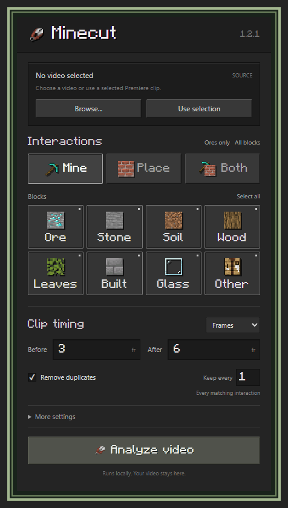
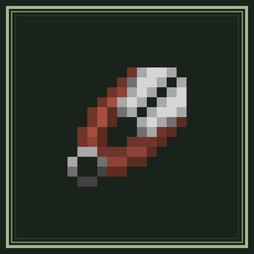

# Minecut

Premiere Pro extension that finds Minecraft block breaks and placements in gameplay footage and turns them into fast cuts.

    

## Prerequisites

To use Minecut, you need:

- **Windows:** 64-bit Windows 10 or 11.
- **Adobe Premiere Pro:** A version supporting CEP extensions. The panel was tested with Premiere Pro 2026.
- **Storage:** About 6 GB for the download. Allow at least 32 GB of free space for extraction and installation, plus space for the analysis cache.
- **GPU:** An NVIDIA GPU and compatible driver are recommended. CPU processing is available but slower.

The Windows release includes the model, Python runtime, PyTorch, and FFmpeg. You do not need to install Python, Git, or the CUDA toolkit for normal use.

### Experimental AMD GPU support

For AMD inference on Windows, install a current AMD graphics driver and the Windows TheRock ROCm/HIP SDK build for your GPU architecture, including rocBLAS and MIOpen. Set `HIP_PATH` to the extracted SDK directory containing `bin`, then restart Premiere. Follow the [ZLUDA Windows HIP setup instructions](https://github.com/vosen/ZLUDA/blob/v7-preview.21/docs/src/hip_sdk.md).

In **More Settings > Device**, select **AMD GPU (ZLUDA, experimental)**. Minecut uses ZLUDA v7-preview.21 with a separate PyTorch 2.7.0 CUDA 11.8 runtime that includes translatable GPU kernels. Both are bundled. Video preparation runs on the CPU. Select **CPU** if the runtime reports a compatibility error.

## Installation

1. **Download the Release:**

    Download all three `Minecut-1.2.2.zip.part` files, `Install-Minecut.cmd`, and `Install-Minecut.ps1` from the [v1.2.2 experimental release](https://github.com/Student-FastDev/Minecut/releases/tag/v1.2.2). Put all five files in the same folder.

2. **Install the Extension:**

    Double-click `Install-Minecut.cmd`. The installer checks the combined archive's SHA-256, extracts it, and starts the included installer. If Minecut is already installed, close Premiere and rename the existing `com.minecut.premiere` folder in `%APPDATA%\Adobe\CEP\extensions` before installing.

3. **Open in Premiere Pro:**

    Restart Premiere Pro and select **Window > Extensions > Minecut**. Some versions call this menu **Extensions (Legacy)**.

    The extension is unsigned. Installation enables Adobe CEP `PlayerDebugMode` for the current Windows user. The installer does not require administrator access.

## Usage

1. **Choose Footage:**

    Select a video clip on the Premiere timeline and click **Use selection** or **Analyze video**. Trimmed clips work too. To analyze an entire source file, use **Browse**. Save your Premiere project before creating a sequence.

2. **Configure the Cut:**

    - **Interactions:** Choose Mine, Place, or Both and select block categories.
    - **Clip Timing:** Set source frames or seconds before and after each detected event.
    - **Remove Duplicates:** Keep one cut from overlapping detections. Turn it off to retain nearby real interactions.
    - **Keep Every:** Choose every event or, for example, every tenth event.
    - **More Settings:** Set Max audio alignment, audio track, peak handles, sampling, spacing, clip limit, montage length, ordering, device, and batch size.

3. **Analyze and Create the Sequence:**

    Click **Analyze video**, review the result, then click **Create sequence**. Minecut imports a new sequence with linked video and audio. After changing the cut settings, use **Rebuild cut** to reuse the cached predictions.

## Model Architecture

Minecut uses a custom PyTorch audiovisual event spotter inspired by [AdaSpot: Spend Resolution Where It Matters for Precise Event Spotting](https://openaccess.thecvf.com/content/CVPR2026/html/Xarles_AdaSpot_Spend_Resolution_Where_It_Matters_for_Precise_Event_Spotting_CVPR_2026_paper.html) (Xarles et al., CVPR 2026). AdaSpot learns an adaptive high-resolution region of interest. Minecut instead uses a **fixed centre crop**, adds a full-rate motion branch and audio gating, and predicts separate break and place sequences. It is an adaptation, not the published AdaSpot model.

**Input and windowing:** Constant-frame-rate source video is decoded into a 224 × 128 global view and a 160 × 160 centre detail view. The global view is padded to 224 × 160 and concatenated with the detail view, yielding 160 × 384 RGB proxy frames. The model processes **96-frame windows** with a **48-frame stride**. It takes the central 48 positions `[24, 72)` from each window and assembles them on the source timeline, preserving their timestamps. At 60 fps, one window spans 1.6 seconds and each core covers 0.8 seconds. Windows include neighbouring context and are not limited to one event.

**Visual encoders:** The global and centre views run through separate `regnety_002` CNNs every other frame. Both use 368-dimensional features and adapted [Gate-Shift-Fuse](https://arxiv.org/abs/2203.08897) modules for temporal feature exchange. The two streams are interpolated back to all 96 source-frame positions, projected by separate MLPs, and merged by an elementwise maximum. The CNN family follows [Designing Network Design Spaces](https://openaccess.thecvf.com/content_CVPR_2020/html/Radosavovic_Designing_Network_Design_Spaces_CVPR_2020_paper.html) (Radosavovic et al., CVPR 2020).

**Audio and fusion:** The first source audio stream is converted to mono 16 kHz. A 400-sample STFT window, 160-sample hop, and 512-point FFT produce 64 log-mel bands sampled at the source-frame timestamps. Two 1D convolutions map 64 → 96 → 368 features. A learned sigmoid gate combines the visual features, audio features, and an audio-presence mask. When audio is absent, the mask sets its contribution to zero. The fused features and normalized frame rate enter a bidirectional GRU with 368 hidden units in each direction, producing 736 features per frame.

**Motion and temporal heads:** A separate native-frame branch resizes proxy frames to 40 × 96, concatenates RGB and differences from the previous frame, and applies three 2D convolution layers and pooling to produce 64 motion features. GRU features, the 368-dimensional detail stream, and motion features are concatenated into 1,168 features. A 1×1 projection reduces these to 256 channels, followed by four residual temporal blocks with dilations **1, 2, 4, 8**. A 1D convolution emits two independent action logits per frame.

**Category and event decoding:** Each action has a category head that combines the GRU output with detail features from two frames before a break or two frames after a placement. A second category projection from the 256-channel temporal features is added to those logits. The output contains eight broad categories per action. After the 48-frame cores are assembled, sigmoid probabilities are compared with the checkpoint's validation-selected **0.6 threshold**. For each action, consecutive above-threshold frames form a token run. The highest-confidence frame in the run supplies the timestamp and category. This is CTC-style run collapsing over binary action streams. The inference decoder does not impose a fixed event count per video or apply distance-based NMS. The optional overlapping-cut duplicate control is a separate editorial heuristic.

**References:**

- Xarles et al., [AdaSpot: Spend Resolution Where It Matters for Precise Event Spotting](https://openaccess.thecvf.com/content/CVPR2026/html/Xarles_AdaSpot_Spend_Resolution_Where_It_Matters_for_Precise_Event_Spotting_CVPR_2026_paper.html), CVPR 2026. [Official implementation](https://github.com/arturxe2/AdaSpot).
- Sudhakaran et al., [Gate-Shift-Fuse for Video Action Recognition](https://arxiv.org/abs/2203.08897), IEEE TPAMI 2023. [Official implementation](https://github.com/swathikirans/GSF).
- Radosavovic et al., [Designing Network Design Spaces](https://openaccess.thecvf.com/content_CVPR_2020/html/Radosavovic_Designing_Network_Design_Spaces_CVPR_2020_paper.html), CVPR 2020.

The included checkpoint is [`model/model.pt`](model/model.pt). Its SHA-256 is `7f9ad0b4290fa99c343f030903a4ede572a90ecff35de72b2bb5361a3cfb3106`.

## Dataset and Evaluation

The training dataset combined automatically recorded Minecraft interactions, first-person MCSR Ranked replay exports, and a separate recording of human gameplay. Synthetic capture recorded frame-aligned break and placement events across different blocks, tools, lighting, camera movement, audio conditions, and backgrounds. Replay and human gameplay supplied longer natural sequences and non-event footage. Timeline windows included event examples and negatives. Replays were grouped by world seed for the training and evaluation split, synthetic workers were held out, and the human recording was separated temporally with guards. Datasets and training code are not included in this repository.

The held-out test contained 13,911 grouped interactions across 8.16 usable hours. At ±3 source frames, pooled **action precision / recall were 98.65% / 98.69%**, with **23.05 false positives per hour**. Requiring the correct broad category gave **97.11% / 97.15%** precision / recall. On the single human-gameplay temporal holdout, action precision / recall were **97.24% / 86.14%** across 368 events. Results can differ for new players, texture packs, edits, or gameplay styles. Review the generated cuts before publishing.

## Notes

- **Local Processing:** Footage and analysis remain on the computer. Work files are stored under `%LOCALAPPDATA%\Minecut`.
- **Max Audio:** The usual Before / After values define the search window. The loudest sample in the selected audio track determines the peak frame, and separate peak handles define the final cut. Speech or music may be louder than game sounds.
- **Timeline Limitations:** The original media is analyzed. Timeline effects are not rendered. Nested sequences, reversed clips, speed changes, and variable-rate or discontinuous footage are not supported.
- **Performance:** GPU batching, hardware decode when available, cached predictions, and bounded prefetch help throughput. Larger batches can use more memory and are not always faster. Duration depends on codec, hardware, and footage.
- **Source Code:** This repository contains the extension and inference code, plus the checkpoint. The release includes the standalone runtime and FFmpeg. Third-party and Minecraft asset notices are in `licenses`.

---

  
    

